# ProQuiz

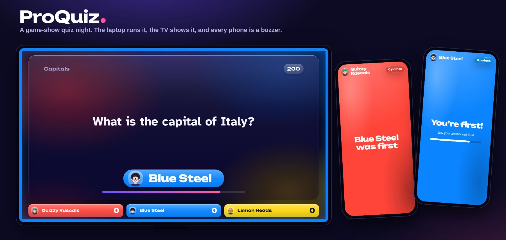

A Jeopardy-style quiz for teams in the same room. A laptop runs the game, a TV shows the board, and every team uses a phone as a buzzer. No internet is needed: everything runs over the room's Wi-Fi. (If friends elsewhere want to play too, they can join over the internet. See [Playing with people elsewhere](#playing-with-people-elsewhere).)

- A board of categories and questions (100–500 points). The team that answers right picks the next question.
- Phones buzz in, and the first team is shown on the TV in its colour. A wrong answer costs points (none, half or all, your choice), and the other teams can try.
- Game-show sounds, a different buzz note for each team, and timers.
- Background music, Kahoot style: a lobby tune, thinking music while the buzzers are on, suspense in the final, and party music at the end. You can swap in your own music files.
- Pictures and sound clips in questions ("Which song is this?"). A picture can start as big blocks and slowly become clear.
- An optional round 2: a second board with new questions and double points, played before the final. The team with the fewest points picks first.
- A final round: teams bet, type their answers on their phones, and you judge each one.
- Fairer buzzing (optional): the team that pressed first wins, even if its phone has slower Wi-Fi.
- A question editor, English and Norwegian, and an autosave that survives a crash.
- **Players elsewhere (optional):** choose whether players join on this Wi-Fi or over the internet, so friends who aren't in the room can play too, with an optional PIN. See [Playing with people elsewhere](#playing-with-people-elsewhere).
- **Quick quiz (multiple choice):** a second kind of quiz for up to 30 players. Everyone answers on their own phone by tapping a coloured shape, faster right answers score more, and the TV shows a top 5 after every question and a podium at the end. See [Quick quiz](#quick-quiz-multiple-choice).
- **Crazy mode (Kaosmodus):** hidden special tiles, revealed on the TV with a spinning reel. They include bombs, triple points, a hot seat, a rescue for the team in last place, a three-question turbo, a jackpot, a freeze and a Daily Double. You can also place specials yourself in the editor.

## Screenshots

**On the TV**

| | |
|---|---|
| 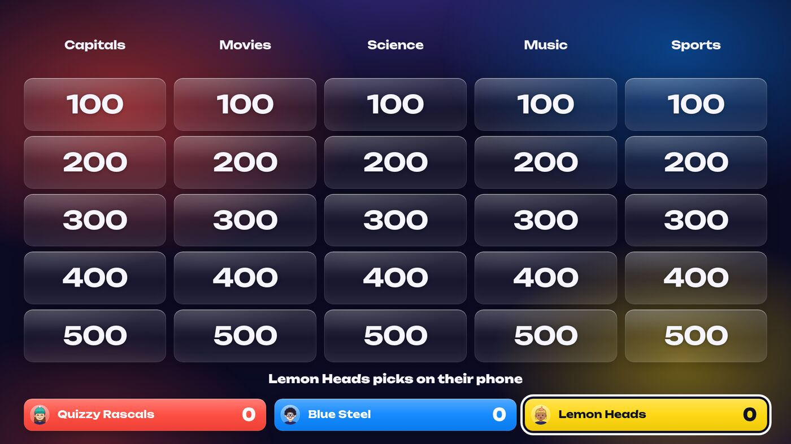 | 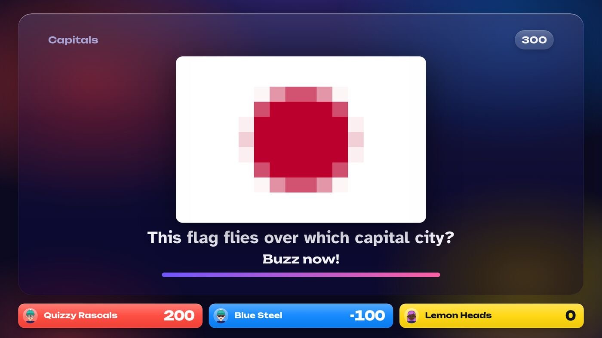 |
| The board | A picture that appears slowly |
| 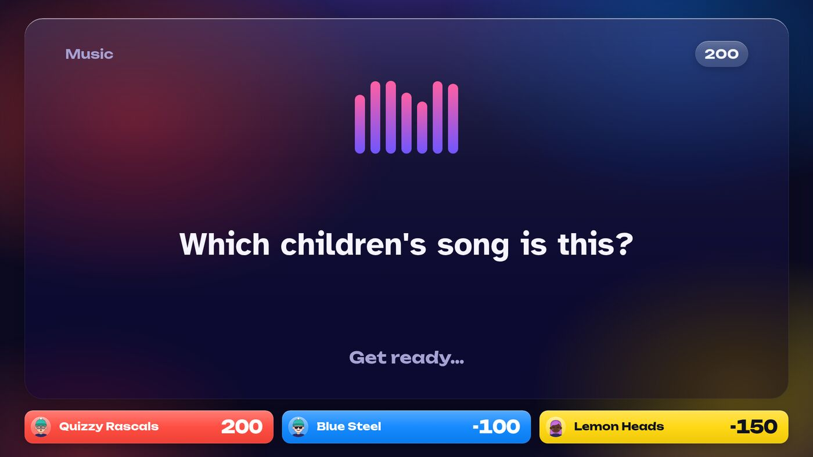 | 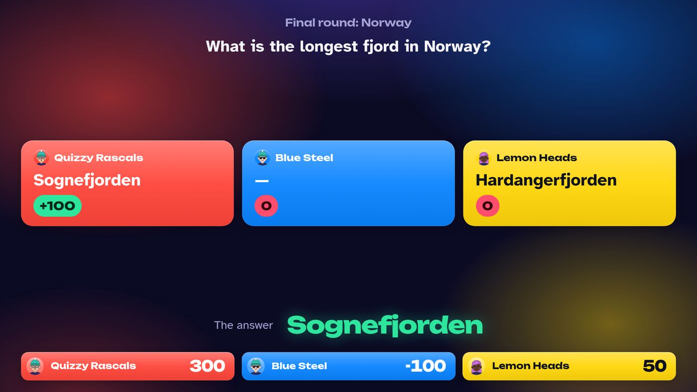 |
| A sound clip question | The final round, judged |
| 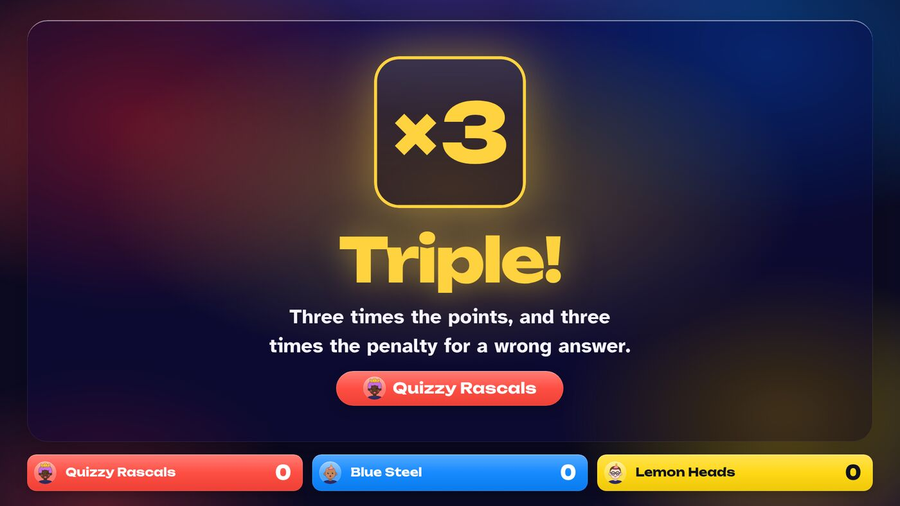 | 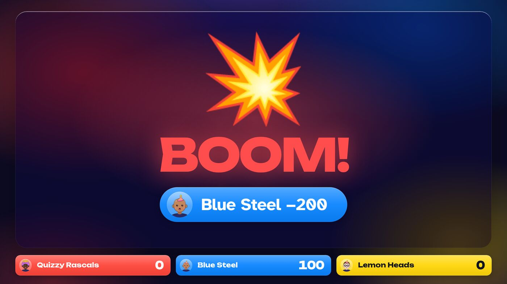 |
| Crazy mode: triple points | Crazy mode: the bomb |

**On the phones**

| | | | |
|---|---|---|---|
| 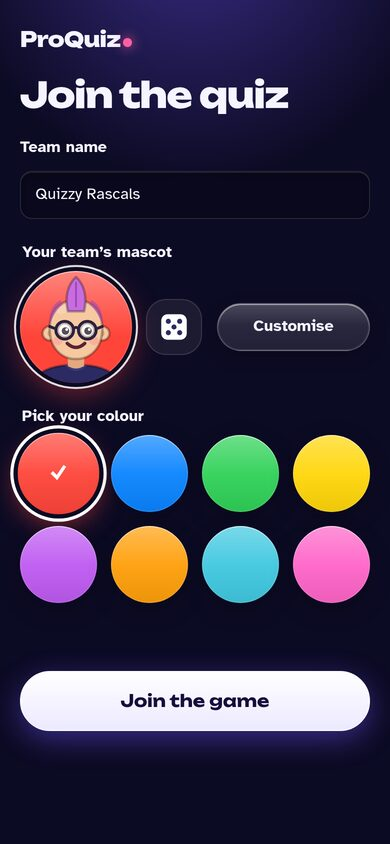 | 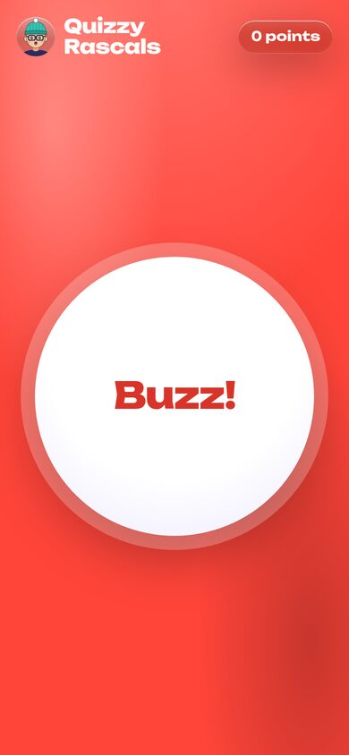 | 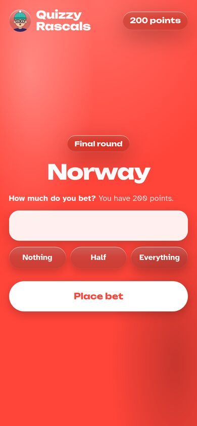 | 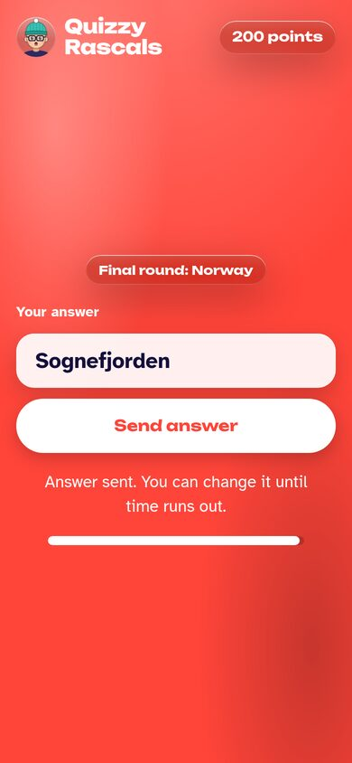 |
| Join with a name, mascot and colour | The buzzer | Bet in the final | Type the final answer |

**On the host laptop**

| | |
|---|---|
| 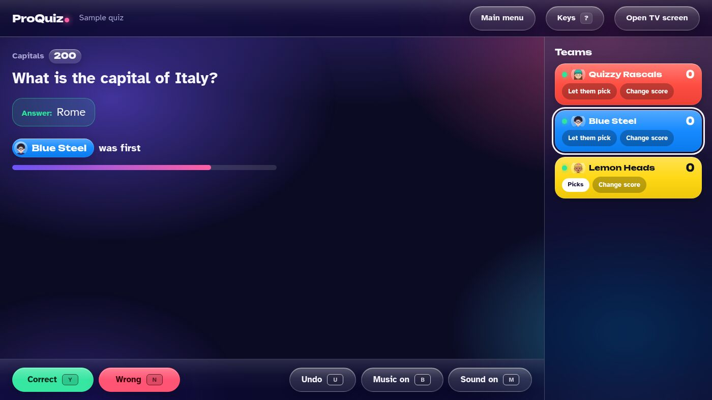 | 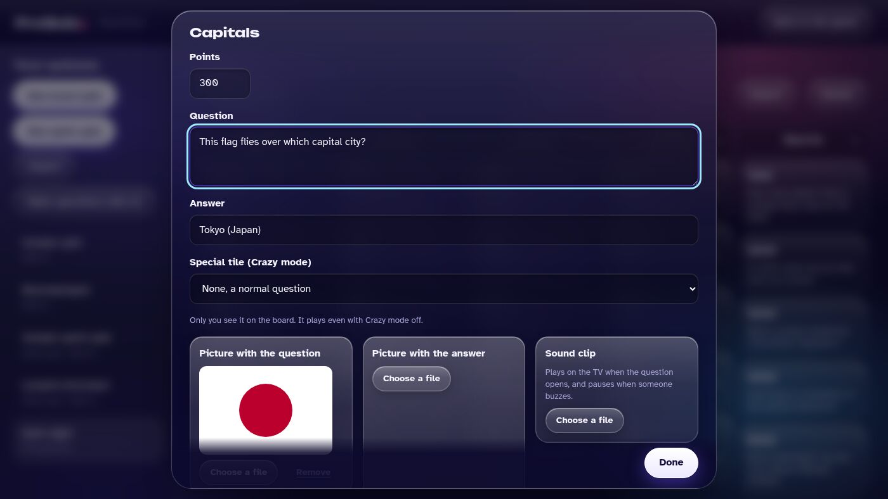 |
| Only you see the answer | The question editor |
| 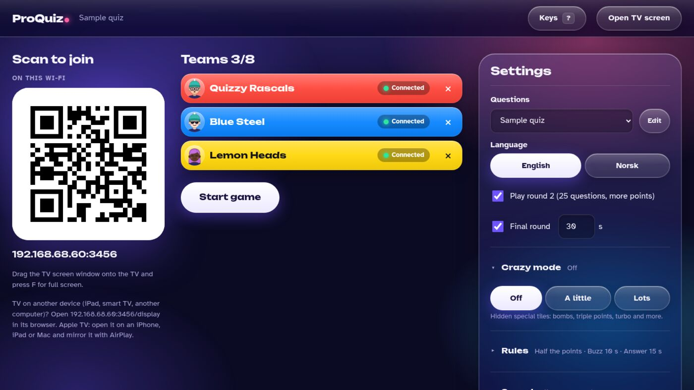 | 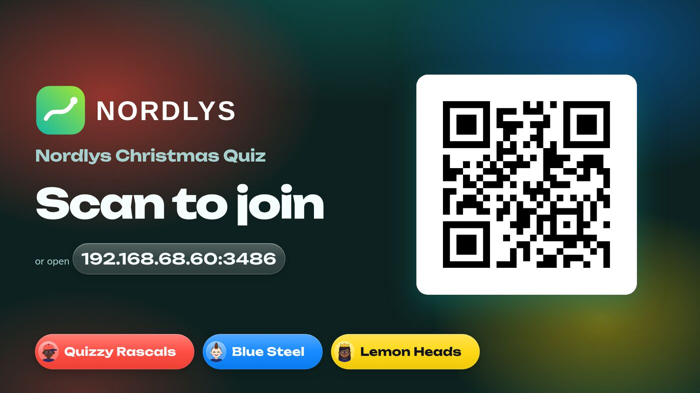 |
| The lobby: teams and settings | Your own logo, name and colour |

**Quick quiz (multiple choice)**

| | |
|---|---|
| 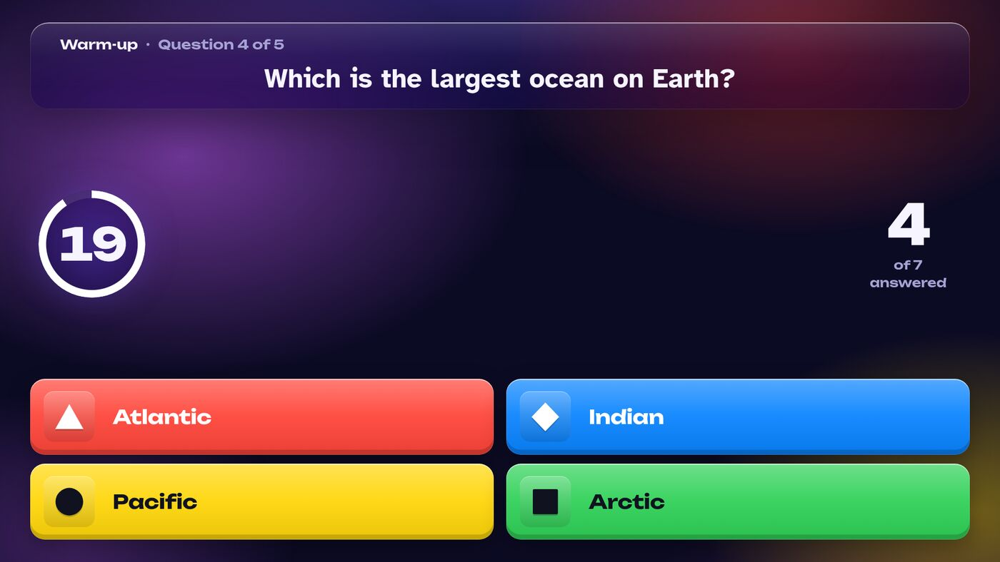 | 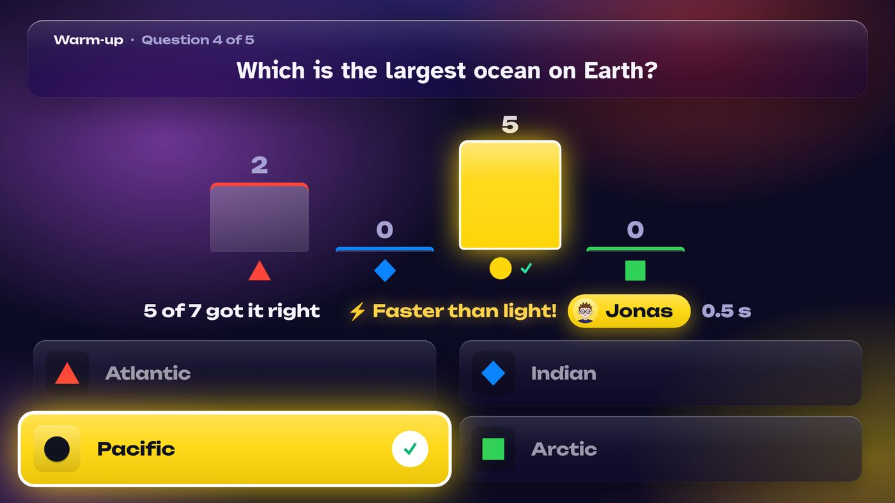 |
| Everyone answers on their phone | How many picked each answer, and who was fastest |
| 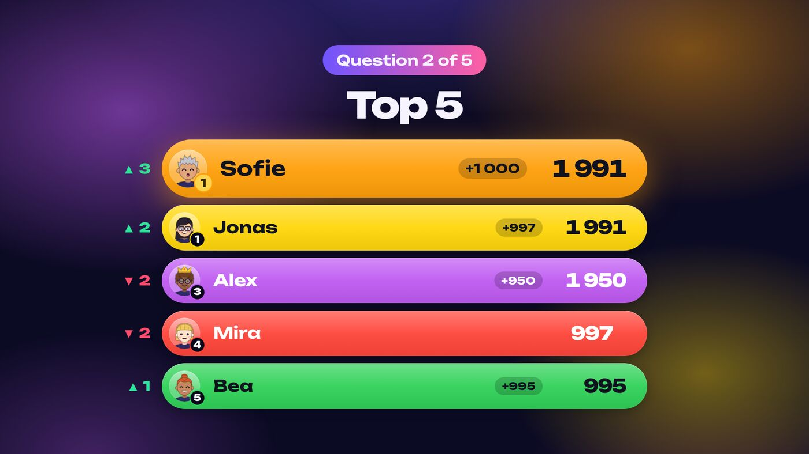 | 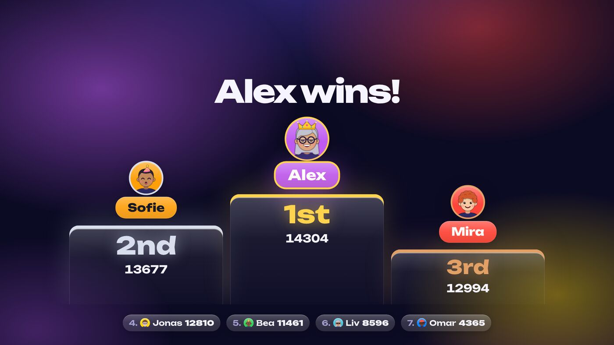 |
| The top 5, animated | The podium |

| | |
|---|---|
| 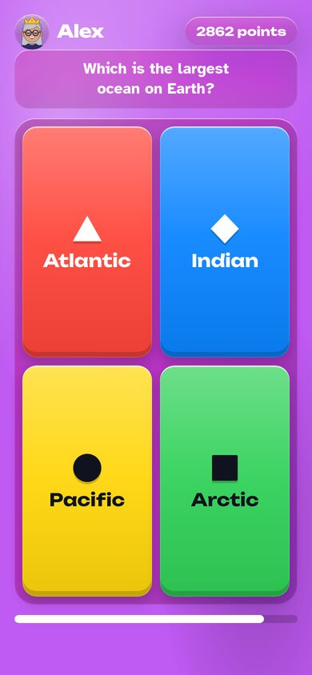 | 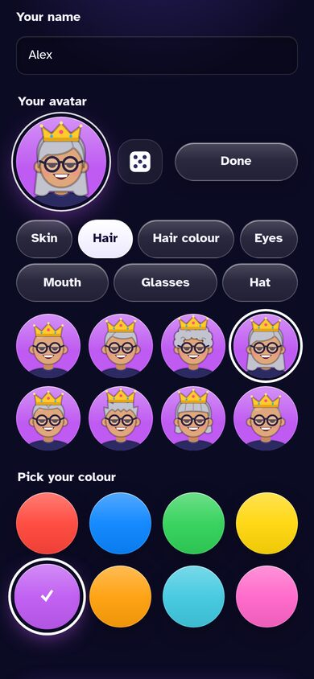 |
| Answer on the phone | Build your own avatar |

## Get it

Download the zip for your computer from the [latest release](https://github.com/dbugger85/proquiz/releases/latest) and unzip it. There's nothing to install. Each zip has a "START HERE" note.

| Computer | Download |
|---|---|
| Windows | `ProQuiz-…-windows.zip` → double-click `ProQuiz.exe` |
| Mac from late 2020 onwards (M1, M2, …) | `ProQuiz-…-mac-apple-silicon.zip` → right-click `ProQuiz` → Open |
| Older Mac (Intel) | `ProQuiz-…-mac-intel.zip` → right-click `ProQuiz` → Open |
| Linux | `ProQuiz-…-linux-x64.zip` → run `./ProQuiz` |

- **Windows:** before you unzip, right-click the zip → **Properties** → tick **Unblock** → **OK**. Without this, Windows may refuse to start ProQuiz and offer only "Don't run". If it still warns, click **More info → Run anyway**. Then **Allow** network access, or phones can't connect. The program isn't signed (signing costs money), which is why Windows is careful.
- **Mac** blocks a normal double-click the first time for the same reason. Right-click → **Open** once, and allow incoming connections if asked.

## Before the night

1. Start ProQuiz. Your browser opens the **host screen**.
2. Click **Edit questions** to make your quiz. Click a tile to write its question and answer, and add a picture or sound clip if you like. The editor saves by itself, and a list under the board tells you what's missing. Two sample quizzes are included, in English and Norwegian, each with a round 2.
   - **Round 2:** tick **This quiz has a round 2** under the board. A second board appears, the same size, with double points (you can change them). Write its questions like the first board's.
   - **A multiple-choice quiz instead?** Click **New quick quiz**. See [Quick quiz](#quick-quiz-multiple-choice) below.
3. Try it once with two phones, so you know how it feels.

**Find a free picture:** in a question, click **Find a free picture** next to **Choose a file**. Type what you want to see (English words work best on Openverse; Wikimedia Commons also knows Norwegian names, and is good for flags, maps, places and famous people), click a picture to see it bigger, and click **Use this picture**. Keep **Free for any use** for company events; **Also non-commercial** adds more pictures that are only fine for a quiz with friends. The picture is copied into your quiz, so the game doesn't need the internet; only the search does. Who made it and its licence are kept with the quiz (listed under **Picture credits**), and the TV shows them in small text after the answer (turn that off under **Look and branding** in the lobby).

**Make a quiz with AI:** in the editor, click **Make questions with AI**. Type a few topics (one per line, each becomes a category), add example questions if you like, and choose the difficulty (kids 5–9, easy, medium, hard or expert), the board size, the final question, a round 2 (with its own topics if you like) and the language. Click **Copy the request**, paste it into Claude or ChatGPT, then copy the AI's whole answer back into the box and click **Fill the board**. Your new quiz opens in the editor. **Check every answer: AI can get facts wrong.** ProQuiz itself never contacts an AI.

**Fill the empty spots with AI:** started a quiz but ran out of ideas? Open it in the editor and click **Fill empty spots with AI** under the board. ProQuiz shows what is missing (empty questions, questions without an answer, answers without a question, category names, the final), on both boards if the quiz has a round 2. The request includes everything you have already written, so the AI matches its topics, difficulty and language and avoids repeating your answers. You can choose a difficulty yourself, and give topics for categories that are completely empty. Paste the answer back and only the empty spots are filled: nothing you wrote changes, and the new tiles get a dashed edge so you can check them. Picture and sound questions without an answer are left for you, because the AI can't see them.

**Ready-made quizzes to import** (download the file, then **Import** in the editor):
- [Barnequiz 2 (5–9 år)](examples/barnequiz-2.proquiz.json): a Norwegian quiz for children aged 5 to 9, about animals, food, fairy tales, numbers, Norway and the world, and nature and space, with six pictures.
- [Lynquiz for barn (6–9 år)](examples/lynquiz-barn.proquiz.json): a Norwegian Quick quiz (multiple choice) for children aged 6 to 9, in four sections (animals, fairy tales and cartoons, numbers and shapes, Norway and the world), with four pictures and a double-points last question.

## On the night

1. **Wi-Fi:** connect the laptop and all the phones to the **same Wi-Fi**.
2. **Start** ProQuiz. Keep its black (or Terminal) window open while you play.
3. **TV:** the TV screen is a web page, so you can show it in two ways.
   - **With a cable:** connect the laptop to the TV as a **second screen** (extend, not mirror). On the host screen click **Open TV screen**, drag that window onto the TV, and press **F** for full screen. Click the TV screen once so it's allowed to play sound.
   - **On another device on the same Wi-Fi** (an iPad, another computer, or a smart TV with a web browser): open the TV address in its browser. ProQuiz prints that address when it starts, and the host lobby shows it under the QR code (something like `192.168.1.23:3000/display`). Tap the screen once to turn on the sound. As soon as it connects, the laptop shows the host view with the answers, instead of the TV view.
     - **Apple TV** has no web browser. Open the TV address on an iPhone, iPad or Mac, then use **Screen Mirroring** (AirPlay) to send it to the Apple TV. Turn the iPhone or iPad sideways, and keep it plugged in. Mirroring shows the picture a split second late, but that doesn't change who buzzed first.
     - Smart TV browsers differ, and ProQuiz hasn't been tested on them. If the sound or the board doesn't work there, use a cable or an iPad instead.
   - **Only one screen** (just the laptop, or the laptop mirrored to the TV)? Skip "Open TV screen". Once the game starts, the laptop shows the TV view itself, with the controls underneath: click the tiles on the board, and the answers stay hidden until you reveal them. Press **H** to peek at the host view (with the answer and score changes), and **H** again to go back. **F** is full screen.
4. **Teams join:** they scan the QR code on the TV, type a team name and pick a colour. They can press **Try your buzzer** to hear their tone.
5. **Settings:** the lobby's settings come in folding sections, and a closed section shows a short summary of what's set.
   - **At the top:** choose the quiz and the language, and tick round 2 and the final round on or off (with the time for the final answer).
   - **Crazy mode** (already open): off, a little or lots, and which specials to use.
   - **Rules:** what a wrong answer costs, the timers, picking on the phone and fairer buzzing.
   - **Sound:** effects, music and the volume. **Your own music**, at the end of this section, lets you choose a music file for each moment (lobby, between questions, thinking, final, after the game).
   - **Look and branding:** the **Glass look** (on by default): frosted, see-through panels with a soft glow slowly moving behind them, on the TV, the phones and the laptop. Untick it if the TV or an older laptop stutters, and every screen switches to the plain look at once. Underneath, your own [branding](#your-own-logo-and-colours).
6. **Round 2:** if the quiz has a round 2, **Play round 2** is ticked in the lobby. Untick it to skip it tonight.
7. **Fairer buzzing:** tick it if close calls matter. Normally the laptop goes by whose buzz *arrives* first, so a phone with weak Wi-Fi can lose by a few hundredths of a second. With this on, ProQuiz measures how slow each phone's Wi-Fi is (you'll see it in milliseconds next to each team) and goes by who *pressed* first. The winner shows a tiny moment later (0.15 s), which most people won't notice.
8. **Picking on the phone:** with **Teams pick the next question on their phone** ticked (it is by default), the team whose turn it is chooses a category and then the points on its phone, and the question opens on the TV at once. You can always click a tile on the laptop instead, for example if their phone has run out of battery.
9. **Start game.**

### Your own logo and colours

In the lobby's **Look and branding** section you can make ProQuiz look like your company's or your event's:

- **Logo:** click **Choose a logo…** and pick a picture (PNG, JPG, SVG or WebP, up to 2 MB). It replaces the "ProQuiz" name in the top left corner of the TV (during the whole game), the laptop, the editor and the phones' join screen, and shows big on the TV's "Scan to join" screen and on the winner's screen. A logo with transparent edges looks best. If it is dark and hard to see on the dark screens, tick **White backing behind the logo**. **Remove logo** brings back "ProQuiz".
- **Event name** (optional), for example "Office Christmas Quiz": shown on the TV's "Scan to join" screen, on the winner's screen and on the phones when players join.
- **Accent colour:** ProQuiz's own violet, blue, teal, green, orange or red, or the **+** for a colour of your own. It colours the buttons, the highlights and the glow in the background on every screen. Team colours don't change. A very light colour is made a little darker, so white text on it stays easy to read.

Every screen changes at once. Your branding is kept in the ProQuiz folder (`brand`), so it stays for every quiz and the next time you start ProQuiz, and it is never part of an exported quiz. It can only be changed on the laptop running ProQuiz.

### Crazy mode (Kaosmodus)

Turn it on in the lobby's settings: **A little** hides about 3 special tiles on a 5×5 board, and **Lots** about 6. They land anywhere, and nobody (except you, on the laptop) knows where. Untick any specials you don't want under **Specials to use**.

**Place specials yourself:** in the editor, open a question and choose a **Special tile**. Its icon shows on the tile in the editor (and on your laptop's board), never on the TV. A quiz's own specials always play, even with Crazy mode off; untick **Use this quiz's own special tiles** in the lobby to play without them. With Crazy mode on, the random specials are added on other tiles.

When a team picks one, the TV spins a reel and lands on the special. Press **Space** to go on.

| Special | What happens |
|---|---|
| ×3 **Triple** | Three times the points, and three times the penalty for every wrong answer |
| 💣 **Bomb** | No question: the picking team loses the tile's points |
| 🔥 **Hot seat** | Only the picking team may answer |
| 🛟 **Rescue** | The team in last place answers alone, and a wrong answer costs nothing |
| ⚡ **Turbo** | The picking team gets three questions in a row, 5 seconds each, with no penalty |
| 💰 **Jackpot** | Every point lost to wrong answers and bombs has gone into a secret pot. Answer right to win it |
| 🧊 **Freeze** | The picking team chooses, on its phone, a team that can't buzz on this question (you can also click it on the laptop) |
| 🎲 **Daily Double** | The picking team bets on its phone first: up to its score, or the board's top value if that's more. Then it answers alone. Right wins the bet, wrong loses all of it (whatever the wrong-answer setting says). If nobody bets, the tile's value is played, and you can also type the bet on the laptop |

### Playing

| Key | What it does |
|---|---|
| Click a tile | Open the question the team picked (or let them pick it on their phone) |
| **Space** | Turn the buzzers on (after reading the question), or go back to the board |
| **Y** / **N** | The answer is correct / wrong |
| **R** | Show the answer (nobody got it) |
| **Esc** | Put the question back (picked by mistake) |
| **U** | Undo the last judgement or score change |
| **P** / **0** | Play or pause the sound clip / play it from the start |
| **M** | Sound effects on or off |
| **B** | Background music on or off |
| **H** | Without a separate TV screen: switch between the TV view and the host view |
| **E** | End the board early and go to round 2 (if it's on) or the final round |
| **?** | Show all the keys |

You also have buttons to **Change score** and **Let them pick** for each team. When the first board is done (or you press **E**), round 2 starts with a big intro on the TV: the team with the fewest points picks first, and **Space** opens the new board. Crazy mode gets new hidden specials on it, and an unwon jackpot carries over. In the final round, the teams bet on their phones, then type their answers. You mark each one **Correct** or **Wrong**, and it flips up on the TV.

**Main menu** (top right, during a game) leaves the game for the lobby, just like closing ProQuiz and starting it again: the game is saved, and the lobby asks **Continue the last game?** Teams' phones show the join form, filled in; they tap **Join** to come back, or are put back in their team when you continue. New teams can join first, and they play on with zero points.

### Quick quiz (multiple choice)

A different kind of quiz, made for many players at once. There is no board and no buzzing: every player answers every question on their own phone, by tapping one of 2 to 4 coloured shapes. The faster a right answer, the more points.

**Making one.** In the editor, click **New quick quiz**.
- A quick quiz is split into **sections**, like rounds in a pub quiz. Each section has a name and a time per question (20 seconds if you leave it empty).
- Click a question to write it. Type 2 to 4 answers and tick **Right** next to the right one. If more than one answer is right ("Which of these is a mammal?"), tick each of them: players still pick one, and any right one counts. Not every answer can be right. For a true-or-false question, leave answers 3 and 4 empty.
- Each question can have its own time, **Normal**, **Double** or **No points**, a picture and a sound clip.
- Use ▲ and ▼ to change the order of questions and sections, and × to remove one. **Add a question** and **Add a section** are under them.
- Two sample quick quizzes are included, in English and Norwegian.
- **Make questions with AI** can make one too: choose **Quick quiz (multiple choice)** at the top, then the number of sections and questions per section. Each topic becomes a section. (**Fill empty spots with AI** is only for board quizzes.)

**In the lobby.** Choose the quick quiz in the **Questions** list (it says **Quick quiz** after its name).
- Each phone is one player, up to 30. Players type their own name, and colours may repeat.
- Crazy mode, the rules, round 2 and the final are hidden, because they belong to the board quiz.
- The **Quick quiz** settings: how long the question shows before the answers appear (4 seconds; 0 waits for you to press Space), a **streak bonus** (+100 for each right answer in a row, up to +500; off by default), and **Show question and answers on the phones** (on by default, so nobody has to look at the TV; turn it off if you want everyone watching the TV).

**Playing.**
1. Each section starts with a title card on the TV, with the standings once anyone has points. Press **Space**.
2. The question shows on the TV. A moment later the answers appear on the TV, and as big coloured buttons on the phones.
3. A right answer is worth 1000 points at once, and less the longer you wait, down to 500 at the last moment (twice that for a double-points question). A wrong answer costs nothing. When every player has answered, the question closes by itself.
4. The TV shows how many picked each answer, the right one (or ones), and who was fastest. Each phone says right or wrong, the player's place, and how many points they are behind the next player.
5. **Space** shows the top 5, with arrows for who moved up or down. **Space** again goes to the next question, the next section, or at the end the podium.

| Key | What it does |
|---|---|
| **Space** | Go on: start the section, show the answers now, stop the clock early, show the top 5, next question |
| **Esc** | Skip this question (nobody scores) |
| **U** | Undo the last step |
| **P** / **0**, **M**, **B**, **H**, **F** | The same as in the board quiz |

### Playing with people elsewhere

Friends who aren't in the room can play too, from their own phone, anywhere with internet. ProQuiz makes a temporary web address for the game with a free service from Cloudflare (no account, nothing to pay).

**What you need:** internet on the laptop while you play, and a small free program from Cloudflare called **cloudflared** (about 40 MB). ProQuiz can download it for you the first time.

**How to do it:**
1. In the lobby, open **How players join** (at the bottom of the settings) and choose **Over the internet** instead of **On this Wi-Fi**.
2. The first time, ProQuiz says cloudflared isn't on this computer. Click **Download cloudflared**. It is downloaded once from Cloudflare's own page on GitHub and kept in the ProQuiz folder (`bin`). Or install it yourself (below) and click **Try again**.
3. While the address is being made (a few seconds), the lobby and the TV say so, and show the Wi-Fi code for now. Then the QR code is the internet one, and it's the only one: everyone uses it, in the room or elsewhere. You can also send the address under it, for example in a chat. It looks like `https://some-random-words.trycloudflare.com`.
4. When you are done, choose **On this Wi-Fi** again (closing ProQuiz turns it off too). Next time you get a new address, so the old one stops working.

ProQuiz remembers the choice. Next time, the internet address is made again when you open the lobby (not before), and it is a new one.

**A PIN (optional).** Tick **Ask players elsewhere for a PIN** to get a 4-digit code. It shows in the lobby and on the TV, and players joining over the internet have to type it. Use it if you post the address somewhere others could see it. **New PIN** makes a new one.

**What players elsewhere see:**
- **Quick quiz:** they can't see your TV, so ProQuiz makes sure **Show question and answers on the phones** is on when the internet address is ready. Then they play just like everyone else.
- **Board quiz:** the phone is only the buzzer, as always. To see the board and the questions, they open the TV page over the internet: the address plus `/display` (the lobby shows it). Or share the TV screen in a video call.
- The host screen, the editor and your quizzes can never be opened over the internet. Only this laptop can.

**Delay.** Over the internet there is a short delay, usually a tenth of a second or two. ProQuiz measures each phone's delay and evens it out: with **Fairer buzzing** on, the earliest press wins even if it arrives a little later, and in a quick quiz a player far away doesn't get fewer points for seeing the answers a moment later. Players who joined this way are marked **elsewhere** in the lobby.

**Installing cloudflared yourself** (instead of the download button), then click **Try again**:
- **Windows:** `winget install --id Cloudflare.cloudflared` in a terminal, or download `cloudflared-windows-amd64.exe` from [github.com/cloudflare/cloudflared/releases](https://github.com/cloudflare/cloudflared/releases), rename it to `cloudflared.exe` and put it next to `ProQuiz.exe`.
- **Mac:** `brew install cloudflared`.
- **Linux:** your package manager, or download `cloudflared-linux-amd64` (or `-arm64`) from the same page, rename it to `cloudflared`, make it executable and put it next to `ProQuiz`.

**Good to know:** the free Cloudflare service is meant for trying things out, so it has no uptime promise. If it stops working, the lobby says so, and during a game a small warning shows at the top of the host screen. Click **Try again** for a new address (the players elsewhere need the new address). Teams can join from anywhere and in the room in the same game.

## If something goes wrong

- **Phones can't connect.**
  - Check they're on the same Wi-Fi as the laptop, not mobile data.
  - Guest or hotel Wi-Fi often stops devices seeing each other. Turn on a hotspot on one phone and put the laptop and all the phones on it.
  - On Windows, check ProQuiz is allowed through the firewall.
- **A phone went to sleep or lost its connection.** Unlock it or reload the page. It comes back as the same team, with the same score.
- **The laptop crashed, or you closed ProQuiz.** Start it again. The host screen asks **Continue the last game?** (So does **Main menu** during a game.)
- **The TV screen on an iPad or smart TV won't open.** Check it's on the same Wi-Fi as the laptop, and type the address exactly as the lobby shows it, including the part after the colon (like `:3000/display`; the number can differ). Guest networks often keep devices apart, so use the main Wi-Fi.
- **Players elsewhere can't join.**
  - Check the laptop has internet, then click **Try again** (under **How players join**, or in the warning during a game) for a new address.
  - "Wrong PIN": the PIN is in the lobby and on the TV, and changes with **New PIN**.
  - If a company or school network blocks it, try another internet connection (like a phone's hotspot).
- **No sound.** Click the TV screen once. Check **Sound effects** is on and the TV isn't muted. Sound clips play from the TV screen, or from the laptop when no TV screen is open.

Your quizzes, their pictures and clips, your logo and colours, and the autosave are kept in a **ProQuiz** folder in your home folder. Use **Export** in the editor to share a quiz, pictures and clips included, and **Import** to open one.

## For developers

```sh
npm install
npm start        # starts the server and opens the host page (PROQUIZ_NO_OPEN=1 to skip)
npm test         # unit and server tests
npm run e2e      # browser tests with a host, a TV and three phones (four in the Quick quiz test), branding, and the picture search
npm run build    # the zips in dist/ (needs Deno and zip)
```

See [CLAUDE.md](CLAUDE.md) for how it's built and [PLAN.md](PLAN.md) for the plan and decisions.
